  

  <a href="https://natlee.github.io">natlee.github.io</a> ·
  <a href="https://natlee.github.io/Blog/">blog</a> ·
  <a href="https://medium.com/@natlee_">medium</a> ·
  <a href="https://www.linkedin.com/in/nat-lee-726525ba/">linkedin</a> ·
  <a href="https://www.kaggle.com/natlee">kaggle</a> ·
  <a href="https://huggingface.co/NatLee">hugging face</a>

I started out in 2018 writing crawlers and NLP models, spent a few years on computer vision and medical imaging, and now work on data platforms and forecasting for electricity trading. Backend work in Python is home base.

Most of what I build now, I build together with AI coding agents. I decide what to make, how the pieces fit and whether it actually works; the agent writes a lot of the code, and I read every change before it ships. That's how a backend person ends up with repos in TypeScript and Rust.

中文 is my first language. I also work in Japanese (JLPT N1) and English.

 

### Where I've been

- `2024` Power trading for the Japanese and Australian markets. Since 2026 I lead the trading data platform, including three months on-site in Tokyo.
- `2023` Solar-generation forecasting, and a power-matching algorithm brought down from O(N⁴) to O(N³) with max-flow.
- `2021` Sentiment analysis over 3 billion+ social-media records.
- `2019` Brain MRI/PET preprocessing for Alzheimer's diagnosis, and pose estimation from fisheye cameras on Jetson boards.
- `2018` Social-media crawlers, a Chinese reading-comprehension service, and Taiwanese Hokkien song recognition for smart speakers.

### Things I've made

**Self-hosted tools**

- [telepy](https://github.com/NatLee/telepy) manages reverse SSH tunnels and jump servers from the browser, terminal included.
- [dev-dock-manager-rust](https://github.com/NatLee/dev-dock-manager-rust) gives everyone on one machine their own Docker dev box, with a web terminal and noVNC.
- [django-docker-gui](https://github.com/NatLee/django-docker-gui) is a web UI for Docker images and containers.

**Images**

- [Batch-crop-images](https://github.com/NatLee/Batch-crop-images) crops a pile of similar images in one pass.
- [Blur-Generator](https://github.com/NatLee/Blur-Generator) makes motion, lens and Gaussian blur with OpenCV.
- [fisheye-warping](https://github.com/NatLee/fisheye-warping) turns top-down fisheye shots into panoramas, and back.
- [nipype-preprocess-on-brain-MR](https://github.com/NatLee/nipype-preprocess-on-brain-MR) is a brain MR preprocessing pipeline built on Nipype.

**Small utilities**

- [HEIC2PNG](https://github.com/NatLee/HEIC2PNG) converts iPhone photos to PNG, on [PyPI](https://pypi.org/project/HEIC2PNG/).
- [obsidian-attachmenter](https://github.com/NatLee/obsidian-attachmenter) keeps Obsidian attachments tidy.
- [lets-copy](https://github.com/NatLee/lets-copy) is a Chrome extension that brings copy back to sites that block it.

**For fun**

- [Play-QWOP-by-Using-AI-Agent](https://github.com/NatLee/Play-QWOP-by-Using-AI-Agent): an actor-critic agent learning to run in QWOP, reading its own score with OCR.
- [GURA](https://github.com/NatLee/GURA-gru-unit-for-recognizing-affect): a BiGRU sentiment model trained on [MyAnimeList reviews](https://www.kaggle.com/datasets/natlee/myanimelist-comment-dataset) I [scraped myself](https://github.com/NatLee/MyAnimeList-comment-crawler).
- zh-TW translations for [poi](https://github.com/poooi/poi), the KanColle browser, and its plugins.

### Upstream

- [open-remote-ssh](https://github.com/jeanp413/open-remote-ssh/pulls?q=is%3Apr+author%3ANatLee+is%3Amerged): 8 merged PRs, including the host list in *Connect to Host*, `known_hosts` verification and ProxyJump fixes.
- [deepface](https://github.com/serengil/deepface/pull/1396): batch age and gender prediction.
- [tensorflow/models](https://github.com/tensorflow/models/pull/6587): fixes for newer TensorFlow and Python 3.
- [nipype](https://github.com/nipy/nipype/pull/3107): a docs fix.

 

  
  

  <picture>
    <source media="(prefers-color-scheme: dark)" srcset="https://raw.githubusercontent.com/NatLee/natlee/output/github-snake-dark.svg" />
    
  </picture>

